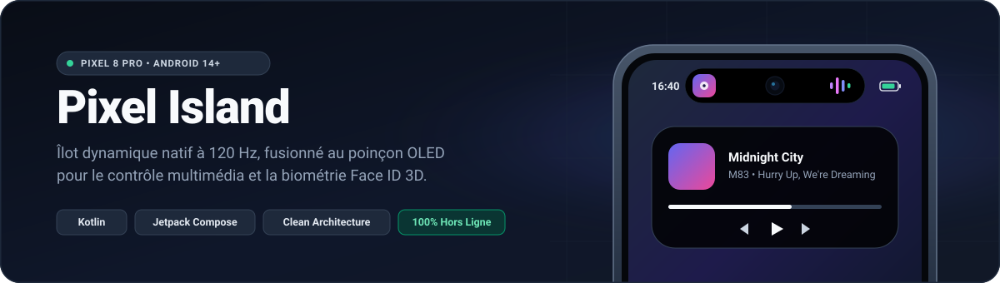
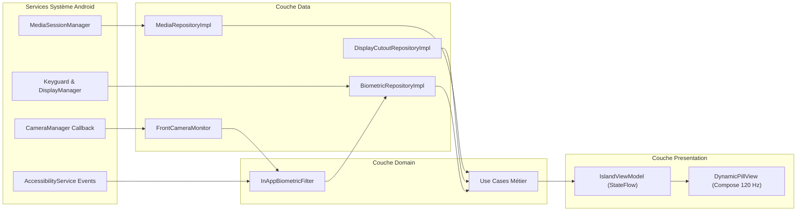

<div align="center">



<br />

[](https://github.com/bdsalocin/pixel_island/actions/workflows/build_apk.yml)
[](https://github.com/bdsalocin/pixel_island/releases/latest)
[-3DDC84?style=flat-square&logo=android&logoColor=white)](https://developer.android.com)
[](https://kotlinlang.org)
[](https://developer.android.com/jetpack/compose)
[](LICENSE)

<p align="center">
  <strong>Une expérience Dynamic Island native, fluide à 120 Hz et ancrée au pixel près sur le poinçon OLED du Google Pixel 8 Pro.</strong>
</p>

<p align="center">
  <a href="https://github.com/bdsalocin/pixel_island/releases/latest">Télécharger l'APK</a> •
  <a href="https://bdsalocin.github.io/pixel_island/">Démo Web Interactive</a> •
  <a href="#fonctionnalités-et-états-dynamiques">Fonctionnalités</a> •
  <a href="#architecture-logicielle">Architecture</a> •
  <a href="#installation-et-configuration">Installation</a> •
  <a href="#feuille-de-route">Feuille de route</a>
</p>

</div>

---

## Présentation

**Pixel Island** transforme le poinçon de la caméra frontale du **Google Pixel 8 Pro** (et des smartphones Android dotés d'un poinçon central sous Android 11 à Android 14+) en une capsule interactive vivante inspirée de l'écosystème iOS récent.

Contrairement aux surcouches génériques, Pixel Island interroge directement la géométrie matérielle de la dalle (`DisplayCutout`), utilise un noir OLED absolu (`#000000`) qui éteint physiquement les pixels autour de l'objectif, et s'affiche par dessus la barre d'état ainsi que sur l'écran de verrouillage grâce à une fenêtre système `TYPE_ACCESSIBILITY_OVERLAY` sans nécessiter d'accès root.

---

## Fonctionnalités et états dynamiques

L'interface repose sur une capsule permanente affinée style iPhone 18 qui s'étire de manière organique selon le contexte grâce à des animations par ressorts physiques (`SpringSpec` à `120 FPS`).

| État de l'îlot | Dimensions | Rayon | Déclenchement | Interactions tactiles |
| :--- | :---: | :---: | :--- | :--- |
| **Capsule permanente** | `90 × 36 dp` | `18 dp` | État de repos permanent autour du poinçon | Transparente au toucher (`FLAG_NOT_TOUCHABLE`) pour laisser dérouler le volet de notifications |
| **Pilule musicale** | `180 × 40 dp` | `20 dp` | Lecture audio active (`MediaSessionManager`) | **Appui court** : ouvre le lecteur<br>**Appui long** : déploie la grande carte avec retour haptique |
| **Carte multimédia** | `384 × 238 dp` | `40 dp` | Appui long sur la pilule musicale | **Scrubbing** sur la barre de progression, contrôles Lecture / Pause / Piste, **glissement vers le haut** pour refermer |
| **Face ID 3D** | `96 × 96 dp` | `28 dp` | Écran de verrouillage ou authentification faciale en application | Animation automatique d'ouverture `3D` du cadenas à la validation biométrique |

### Points forts de l'expérience

* **Capsule permanente style iPhone 18** : centrée sur l'axe vertical exact du capteur frontal avec des marges symétriques, elle préserve l'affichage de l'heure et des icônes système tout en s'effaçant automatiquement en mode paysage lors du visionnage de vidéos ou de sessions de jeu en plein écran.
* **Lecteur multimédia universel** : compatible nativement avec Spotify, YouTube Music, Apple Music, Deezer, VLC et toute application publiant une `MediaSession` Android. Intègre la miniature haute définition de l'album, un égaliseur vectoriel animé en temps réel, des icônes vectorielles inspirées des SF Symbols et une barre de progression tactile interpolée.
* **Cadenas Face ID 3D à 120 FPS** : dessiné directement sur le GPU via `Canvas` Jetpack Compose avec projection orthographique `3D` de l'anse à `26°` et micro rebond mécanique du boîtier lors du déverrouillage.
* **Réveil OLED sans sursaut** : synchronisation fine avec l'état matériel de l'écran (`Display.STATE_ON` et préchauffage VSYNC) afin d'éviter tout clignotement lors de l'appui sur le bouton d'alimentation, accompagnée de la fermeture automatique de la carte multimédia au verrouillage du téléphone.
* **Détection biométrique intelligente dans les applications** : croisement en temps réel entre `CameraManager.AvailabilityCallback` et la fenêtre système `BiometricPrompt` (`com.android.systemui`). Le cadenas Face ID s'affiche lors du déverrouillage d'une application bancaire ou d'un gestionnaire de mots de passe uniquement si la reconnaissance faciale Google est sollicitée, en ignorant les invites purement digitales et les applications photo classiques.

---

## Confidentialité et sécurité

Pixel Island fonctionne **intégralement hors ligne** sur votre appareil. Le fichier [`AndroidManifest.xml`](app/src/main/AndroidManifest.xml) applique le principe du moindre privilège :

* **Zéro accès réseau** : la permission `android.permission.INTERNET` est absente du manifeste. Aucune donnée personnelle, notification ou métadonnée musicale ne peut quitter le smartphone.
* **Zéro capture caméra** : la permission `android.permission.CAMERA` n'est jamais demandée. La détection du déverrouillage facial repose exclusivement sur les signaux publics de disponibilité du capteur fournis par le système Android.
* **Code ouvert et vérifiable** : chaque APK publié dans les Releases est compilé publiquement par GitHub Actions directement depuis le code source de ce dépôt.

---

## Architecture logicielle

Le projet suit les principes de la **Clean Architecture** associée au modèle **MVVM** unidirectionnel en Kotlin et Jetpack Compose.



### Structure du dépôt

```text
pixel_island/
├── .github/workflows/
│   └── build_apk.yml                 # Pipeline CI/CD : tests unitaires, build APK et GitHub Release
├── app/
│   ├── build.gradle.kts              # Configuration Android SDK 34, Kotlin 1.9, Compose BOM
│   └── src/
│       ├── main/java/com/bdsalocin/pixelisland/
│       │   ├── core/
│       │   │   ├── di/               # Injection de dépendances légère (AppContainer)
│       │   │   └── util/             # Gestion calibrée du retour haptique
│       │   ├── data/
│       │   │   ├── camera/           # Observation non intrusive du capteur frontal
│       │   │   ├── receiver/         # Relance automatique au démarrage (BootReceiver)
│       │   │   ├── repository/       # Implémentations Media, Biométrie et DisplayCutout
│       │   │   └── service/          # Services Overlay, Accessibilité et NotificationListener
│       │   ├── domain/
│       │   │   ├── biometric/        # Machine à états pure InAppBiometricFilter
│       │   │   ├── model/            # Entités métier immuables
│       │   │   ├── repository/       # Contrats d'interfaces Domain
│       │   │   └── usecase/          # Cas d'usage atomiques (Lecture, Seek, Biométrie, Cutout)
│       │   └── presentation/
│       │       ├── island/           # IslandViewModel, IslandUiState, DynamicPillView et composants UI
│       │       └── settings/         # Écran d'accueil et tableau de bord des permissions
│       └── test/java/com/bdsalocin/pixelisland/
│           ├── BiometricStatusLifecycleTest.kt
│           ├── InAppBiometricFilterTest.kt
│           ├── IslandViewModelTest.kt
│           └── ScreenOffCollapseTest.kt
├── docs/
│   └── banner.svg                    # Illustration vectorielle d'en tête
├── index.html                        # Simulateur web interactif hébergé sur GitHub Pages
└── LICENSE                           # Licence open source MIT
```

---

## Installation et configuration

### Prérequis matériels

* **Système** : Android 11 minimum (`API 30`), recommandé sous **Android 14 ou supérieur (`API 34`)**.
* **Appareil cible** : calibré nativement pour le **Google Pixel 8 Pro** (compatible avec les appareils dotés d'un poinçon central en haut de l'écran).

### 1. Installer l'application

1. Téléchargez la dernière version de `pixel_island.apk` depuis la page [**GitHub Releases**](https://github.com/bdsalocin/pixel_island/releases/latest).
2. Ouvrez le fichier sur votre smartphone Android pour lancer l'installation.

> [!IMPORTANT]
> **Note Android 13 et Android 14+ (Paramètres restreints)**
> Pour les applications installées en dehors du Google Play Store, Android verrouille par défaut le bouton d'accessibilité. Avant d'activer le service d'accessibilité :
> 1. Ouvrez **Paramètres** > **Applications** > **Pixel Island**.
> 2. Appuyez sur le menu `⋮` en haut à droite puis sélectionnez **Autoriser les paramètres restreints**.
> 3. Validez avec votre code PIN ou votre empreinte.

### 2. Activer les services depuis le tableau de bord

Ouvrez **Pixel Island** et validez les trois cartes d'état présentées à l'écran :

1. **Superposition à l'écran** : autorise l'affichage de la pilule en mode de secours.
2. **Accès aux notifications** (*Pixel Island Music Listener*) : permet à `MediaSessionManager` de détecter la musique en cours et d'envoyer les commandes Lecture, Pause et Recherche temporelle.
3. **Service d'accessibilité** (*Pixel Island Toucher Poinçon*) : ancre la capsule au niveau matériel de la barre d'état et de l'écran de verrouillage.

---

## Compilation et développement

### Prérequis de développement

* **JDK** : version `17` (Temurin recommandé)
* **Gradle** : version `8.5+`
* **Android SDK** : `compileSdk 34`

### Commandes principales

Cloner le dépôt et se placer sur la branche de développement :

```bash
git clone https://github.com/bdsalocin/pixel_island.git
cd pixel_island
git checkout develop
```

Exécuter la suite complète des 25 tests unitaires (JUnit 4 et Kotlinx Coroutines Test) :

```bash
gradle :app:testDebugUnitTest
```

Générer l'APK signé de développement :

```bash
gradle :app:assembleDebug
```

L'APK compilé est généré dans `app/build/outputs/apk/debug/app-debug.apk`.

### Intégration continue (CI/CD)

À chaque envoi sur `develop` ou `main`, le workflow GitHub Actions [`.github/workflows/build_apk.yml`](.github/workflows/build_apk.yml) :
1. Configure un environnement propre sous Ubuntu avec JDK 17 et Gradle 8.5.
2. Exécute l'intégralité des tests unitaires (`:app:testDebugUnitTest`).
3. Compile et signe l'APK avec la clé stable du projet afin de permettre les mises à jour sans désinstallation préalable.
4. Publie automatiquement une nouvelle **GitHub Release** versionnée lors d'une fusion sur la branche `main`.

---

## Feuille de route

- [x] Ancrage matériel sur `DisplayCutout` et noir OLED absolu à `120 Hz`
- [x] Capsule permanente affinée style iPhone 18 (`90 × 36 dp`)
- [x] Lecteur multimédia universel avec grande carte tactile, scrubbing et icônes vectorielles
- [x] Cadenas Face ID `3D` animé sur l'écran de verrouillage sans sursaut au réveil OLED
- [x] Détection Face ID contextuelle dans les applications protégées (`InAppBiometricFilter`)
- [ ] Mode double îlot scindé (pilule musicale à gauche + bulle détachée Minuteur / Chronomètre synchronisée avec Google Horloge)
- [ ] Alertes système temps réel (mise en charge avec pourcentage, bascule Sonnerie / Vibreur / Silencieux, connexion d'écouteurs Bluetooth)
- [ ] Mode immersion optionnel absorbant les notifications flottantes natives (`WRITE_SECURE_SETTINGS` via ADB sans root)
- [ ] Panneau de personnalisation avancée dans l'application (activation par module, dimensions fines et intensité haptique)

---

## Contribuer

Les contributions, retours de bugs et suggestions d'améliorations sont les bienvenus :

1. Créez une branche dédiée depuis `develop` (`git checkout -b feat/nom_de_la_fonctionnalite`).
2. Vérifiez que tous les tests unitaires passent (`gradle :app:testDebugUnitTest`).
3. Utilisez des messages de commit clairs respectant la convention *Conventional Commits* (`feat:`, `fix:`, `docs:`, `test:`).
4. Ouvrez une *Pull Request* ciblant la branche `develop`.

---

## Licence

Distribué sous licence **MIT**. Consultez le fichier [`LICENSE`](LICENSE) pour plus d'informations.

Conçu et développé par **Nicolas de Bressy**.
